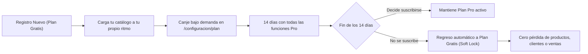

---
title: "Planes, Suscripción y Límites"
description: "Conoce los planes vigentes de VentaSimple (Gratis, Básico, Pro y Negocio), la Prueba Pro de 14 días bajo demanda y la soberanía total de datos."
sidebar:
  order: 1
---

import { Tabs, TabItem, Steps, Aside, Badge } from '@astrojs/starlight/components';

# Planes, Suscripción y Límites

VentaSimple ofrece esquemas de suscripción accesibles en moneda nacional (**MXN**), sin plazos forzosos y diseñados para evolucionar al ritmo de tu negocio.

Puedes consultar tu plan activo, verificar el consumo de tus límites mensuales y realizar mejoras desde la ruta oficial en la plataforma: **`/configuracion/plan`** (o para actualizar: **`/configuracion/plan/upgrade`**).

---

## 1. Tabla Oficial de Planes Vigentes

| Característica / Límite | Plan Gratis | Plan Básico | Plan Pro | Plan Negocio |
| :--- | :--- | :--- | :--- | :--- |
| **Precio Mensual** | **$0 MXN** | **$79 MXN / mes** | **$139 MXN / mes** | **$199 MXN / mes** |
| **Precio Anual** | - | **$790 MXN / año** *(2 meses gratis)* | **$1,390 MXN / año** *(2 meses gratis)* | **$1,990 MXN / año** *(2 meses gratis)* |
| **Ventas al mes** | Hasta 100 ventas/mes | Ilimitadas | Ilimitadas | Ilimitadas |
| **Catálogo de Productos** | Hasta 50 productos | Hasta 500 productos | Ilimitados | Ilimitados |
| **Clientes Registrados** | Hasta 20 clientes | Hasta 100 clientes | Ilimitados | Ilimitados |
| **Cuentas de Usuarios** | 1 usuario | 2 usuarios | 5 usuarios | Ilimitados |
| **Sucursales Físicas** | 1 sucursal | 1 sucursal | Hasta 2 sucursales | Hasta 5 sucursales |
| **Módulos Especializados** | POS estándar | Fiados y Gastos | Agenda, Citas y Mesas | Multi-sucursal y Auditoría Pro |
| **Inteligencia y Reportes** | Métricas básicas | Reportes mensuales | ABC, Predictivo y Mermas | P&L Consolidado Multi-sucursal |

:::tip[Garantía de Continuidad]
Si alcanzas el límite de ventas de tu plan durante el mes en curso, tu información y catálogos nunca se bloquean. Podrás continuar operando y consultando tus datos; simplemente se solicitará actualizar a un plan superior para registrar nuevas ventas.
:::

---

## 2. Prueba Pro de 14 Días Bajo Demanda (Canjeable)

A diferencia de los esquemas tradicionales que activan periodos de prueba inmediatos al registrarse (consumiendo días valiosos mientras el comerciante apenas configura su catálogo inicial), en VentaSimple cada nuevo negocio nace en el **Plan Gratis** con su **Prueba Pro de 14 días disponible para canjear cuando el titular lo decida**:

### Características del Trial Pro
- **Sin tarjeta de crédito requerida:** Se activa en 1 solo clic desde `/configuracion/plan` sin solicitar datos bancarios previos.
- **Canje único por comercio:** Disponible exclusivamente para usuarios con rol `Propietario` (`OWNER`) que se encuentren en el Plan Gratis y no hayan utilizado su beneficio antes.
- **Desbloqueo integral instantáneo:** Otorga durante 14 días catálogo ilimitado, multi-sucursal, usuarios y cajeros adicionales, Centro de Inteligencia y Reportes (P&L, rotación ABC, auditoría de mermas), comisiones por empleado y herramientas de fidelización.
- **Transición limpia al vencer (Soft Lock sin pérdida de datos):** Al expirar los 14 días, la cuenta regresa automáticamente al **Plan Gratis**. Todos los productos, clientes, ventas y configuraciones creadas durante el periodo de prueba se conservan intactos; únicamente se ajusta el registro de nuevas transacciones a los límites normales del plan gratuito.

---

## 3. Soberanía de Datos y Gestión de Cuenta

En VentaSimple la información de tu negocio te pertenece por completo. Desde **Configuración** (`/configuracion`) dispones de herramientas de control soberano:

### Respaldo Completo de Datos en 1 Clic
Puedes descargar una copia íntegra y estructurada de toda la información de tu comercio en formato estándar JSON:
- **Contenido del respaldo:** Catálogo de productos, existencias, clientes, historial de ventas, cortes de caja y compras.
- **Utilidad:** Resguardo offline para auditorías externas, declaraciones fiscales o migración de sistemas sin depender de conectividad a la nube.

### Cancelación y Eliminación Permanente de Cuenta (Zona de Peligro)
Si en algún momento decides no continuar operando en VentaSimple, tienes el derecho de solicitar la destrucción definitiva de tus datos mediante un protocolo de seguridad de tres barreras:
1. **Verificación de Rol Propietario:** Acción restringida exclusivamente al dueño de la cuenta.
2. **Reautenticación obligatoria con contraseña:** Validación de credenciales en tiempo real previa a la solicitud.
3. **Confirmación textual con el nombre del negocio:** Para prevenir eliminaciones accidentales.

Al confirmarse, el sistema purga de forma irreversible la base de datos de la empresa, cancela suscripciones activas y cierra la sesión de forma limpia.

---

## 4. Administración y Facturación de la Suscripción

<Steps>
1. **Acceso al Panel de Suscripción:**
   - Dirígete a **Configuración > Mi Plan** (`/configuracion/plan`).
   - Visualiza en tiempo real los medidores de consumo de ventas, productos dados de alta y clientes activos.
2. **Métodos de Pago Aceptados:**
   - Tarjetas de débito y crédito respaldadas por pasarelas de pago seguras (Mercado Pago / Stripe).
   - Renovación automática mensual o anual según tu preferencia.
3. **Comprobantes y Régimen Fiscal (RESICO / SAT):**
   - VentaSimple emite notas de venta y recibos de pago digitales descargables en PDF/CSV.
   - En cumplimiento con el marco fiscal mexicano, las notas de venta y tickets generados especifican la leyenda reglamentaria sobre comprobantes simplificados.
   - Si tributas en el **Régimen Simplificado de Confianza (RESICO)** o actividad empresarial, puedes descargar el concentrado de ingresos y egresos en CSV desde `/reportes/caja` para conciliar con tu contador o subir a tus declaraciones mensuales del SAT.
</Steps>

