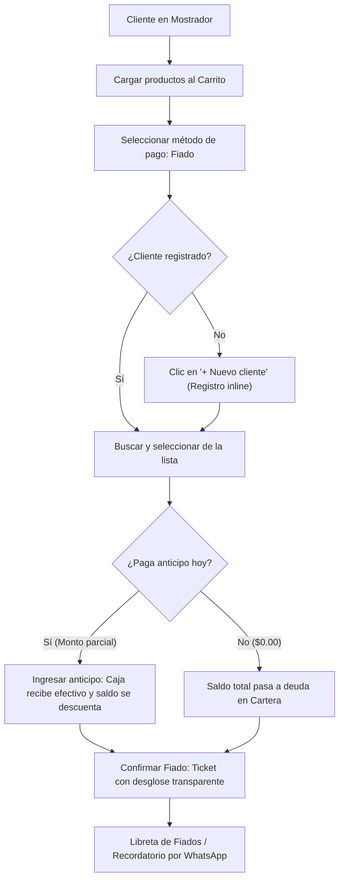

---
title: Control de Fiados, Anticipos y Cuentas por Cobrar
description: Guía operativa completa para fiar en mostrador, registrar clientes rápidos sin salir del carrito, calcular anticipos parciales y cobrar abonos con liquidación FIFO.
sidebar:
  order: 4
head:
  - tag: meta
    attrs:
      name: keywords
      content: como fiar en punto de venta, libreta de fiados digital, anticipo fiado, abonos clientes tienda, cuentas por cobrar punto de venta
---

import { Steps, Aside, Tabs, TabItem } from '@astrojs/starlight/components';

Tener una libreta de papel para anotar los fiados suele causar cuentas perdidas, malentendidos con los clientes y dinero que nunca regresa a la caja.

En VentaSimple puedes llevar tu libreta digital en tiempo real: asignas compras a crédito directamente en el mostrador, registras anticipos parciales en el acto, das de alta clientes nuevos sin perder la venta y aplicas abonos con liquidación automática de notas antiguas (método FIFO).

<Aside type="note">
El registro básico de clientes está disponible en todos los planes. La libreta digital de fiados y cuentas por cobrar con límite de crédito requiere contar con el **Plan Básico+** activo en tu negocio.
</Aside>

---

## Cómo Fiar una Venta en Mostrador (`/ventas/nueva`)

Cuando un cliente de confianza solicita fiado al momento de cobrar, no necesitas cancelar la venta ni salirte de la pantalla:

<Steps>
1. **Agrega los productos al carrito:**
   Escanea o selecciona los artículos que el cliente se llevará normalmente.

2. **Selecciona el método Fiado:**
   En el bloque de **Método de Pago** en el panel lateral derecho del carrito, pulsa el botón **Fiado**.
   - Si deseas registrar un anticipo previo, puedes teclearlo en el campo **Anticipo (opcional)** del carrito.

3. **Confirma en el modal "¿A quién se le fía?":**
   El sistema desplegará un modal optimizado para mostrador y dispositivos móviles:
   - **Desglose financiero transparente:** Visualiza en grande el monto exacto de **Queda a deber (Fiado)**, junto con el **Total de la venta** y el **Abona hoy (Anticipo)**.
   - **Preselección inteligente:** Si ya habías seleccionado al cliente en el carrito, vendrá precargado automáticamente.
   - **Búsqueda inmediata:** Teclea el nombre o teléfono; la lista de resultados coincidentes se despliega al instante con diseño accesible.

4. **Alta rápida sin perder la venta (`+ Nuevo cliente`):**
   Si la persona aún no está registrada en tu directorio, pulsa el botón **Nuevo cliente** dentro del mismo modal.
   - Introduce únicamente su **Nombre completo** (obligatorio) y su **Teléfono de WhatsApp** (opcional para recordatorios).
   - Pulsa **Guardar y seleccionar**. El cliente queda registrado en tu base de datos y asignado a la venta en curso sin reiniciar el mostrador.

5. **Confirmar fiado:**
   Presiona **Confirmar fiado**. El inventario se descuenta de inmediato, el anticipo entra a la caja del día (si se registró alguno) y el resto queda archivado en la cuenta por cobrar del cliente.
</Steps>

<Aside type="tip">
Puedes fijar un **límite de crédito** a cada cliente desde su perfil en el directorio. Si el monto fiado supera el saldo permitido, el sistema te advertirá en pantalla para evitar sobreendeudamientos.
</Aside>

---

## Desglose de Anticipos Parciales

VentaSimple permite dividir la operación de forma transparente cuando el cliente no lleva el dinero completo pero desea abonar una parte de inmediato:

| Concepto | Ejemplo Numérico | Impacto Operativo |
| :--- | :--- | :--- |
| **Total de la Venta** | **$150.00** | Descuenta la totalidad del inventario vendido. |
| **Abona Hoy (Anticipo)** | **$50.00** | Ingresa a la Caja Chica en efectivo/tarjeta del turno actual. |
| **Queda a Deber (Fiado)** | **$100.00** | Se añade al saldo deudor del cliente en Cartera de Fiados. |

El ticket emitido (impreso o enviado por WhatsApp) desglosa con total claridad el total, el anticipo entregado y el saldo remanente para evitar confusiones futuras.

---

## Cómo Consultar la Cartera de Clientes que Deben (`/clientes`)

Para auditar quién te debe y cuánto dinero tienes pendiente de cobro:

1. Entra al menú **Clientes y Fiados** (`/clientes`).
2. En la cabecera encontrarás dos pestañas principales:
   - **Directorio:** Catálogo completo de contactos, historial y membresías.
   - **Fiados:** Vista financiera que muestra el monto total acumulado por cobrar en tu comercio.
3. En la pestaña **Fiados**:
   - Cada cliente deudor cuenta con una tarjeta independiente.
   - Se muestra su nombre completo, teléfono, monto total adeudado y cantidad de notas pendientes.
   - Si el cliente cuenta con saldo a favor de cobros anteriores, se resalta en verde.

---

## Cómo Cobrar y Registrar un Abono (Liquidación FIFO)

Cuando un cliente acude a abonar dinero a su cuenta pendiente:

<Steps>
1. **Localiza al cliente en la pestaña Fiados:**
   Pulsa el botón **Cobrar / Abonar** en su tarjeta.

2. **Elige la modalidad de abono:**
   - **Abono General (Método FIFO - First In, First Out):** Al registrar un abono global, el sistema liquida primero las notas de venta más antiguas y distribuye el remanente a las más recientes.
   - **Abonar a nota específica:** Si el cliente desea saldar una compra en particular, despliega su historial y pulsa abonar sobre esa nota específica.

3. **Captura el importe recibido:**
   Escribe el monto en el teclado o usa los atajos rápidos (**Liquidar Todo**, **50%**, **$100**, **$200**, **$500**).

4. **Selecciona la vía de cobro:**
   Elige si el abono se realizó en **Efectivo**, **Transferencia bancaria** o **Tarjeta**.

5. **Confirma el abono:**
   Pulsa **Confirmar Abono**. El saldo del cliente se actualiza de inmediato.
</Steps>

### Saldo a favor por pago excedente
Si un cliente debe $180 pero paga con $200 y solicita dejar el resto a cuenta, la deuda actual queda saldada en $0.00 y los $20 excedentes se conservan como **Saldo a Favor** para aplicarse automáticamente en su próxima compra.

### Retiro automático de la lista de deudores
En cuanto un cliente liquida el 100% de su saldo pendiente, su tarjeta se retira automáticamente de la pestaña de Fiados, manteniendo la vista limpia con solo las personas que tienen adeudos activos.

---

## Envío de Comprobantes y Recordatorios por WhatsApp

Para agilizar la cobranza con cordialidad y sin fricciones, puedes enviar recordatorios desde la aplicación:

<Tabs>
  <TabItem label="Comprobante de Abono">
    Al finalizar un abono, pulsa **Enviar Comprobante por WhatsApp**. Se abrirá una conversación preconfigurada con folio, fecha, importe abonado y saldo restante actualizado.
  </TabItem>
  <TabItem label="Recordatorio Resumido">
    Desde el perfil del deudor, pulsa la opción de WhatsApp y selecciona **Resumen**. Genera un mensaje cordial con el total de notas pendientes y saldo total acumulado.
  </TabItem>
  <TabItem label="Estado de Cuenta Detallado con CLABE">
    Si el cliente solicita el desglose para transferir por banca móvil, elige **Detallado**:
    - Incluye el detalle de artículos adquiridos en cada fecha.
    - Si configuraste tu cuenta bancaria en el sistema, adjunta automáticamente el banco, beneficiario y los 18 dígitos de tu cuenta CLABE.
  </TabItem>
</Tabs>